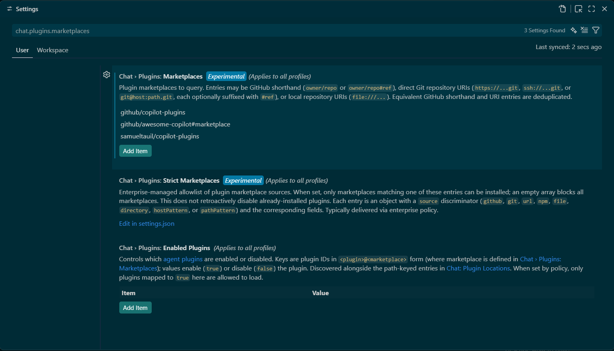
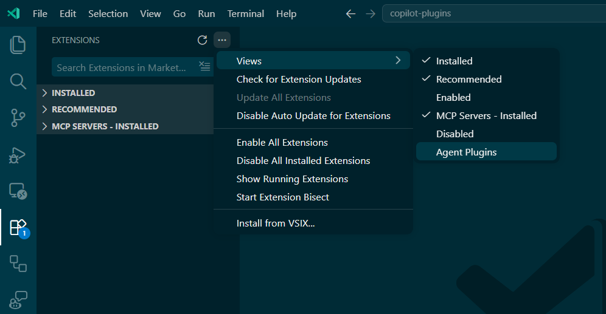
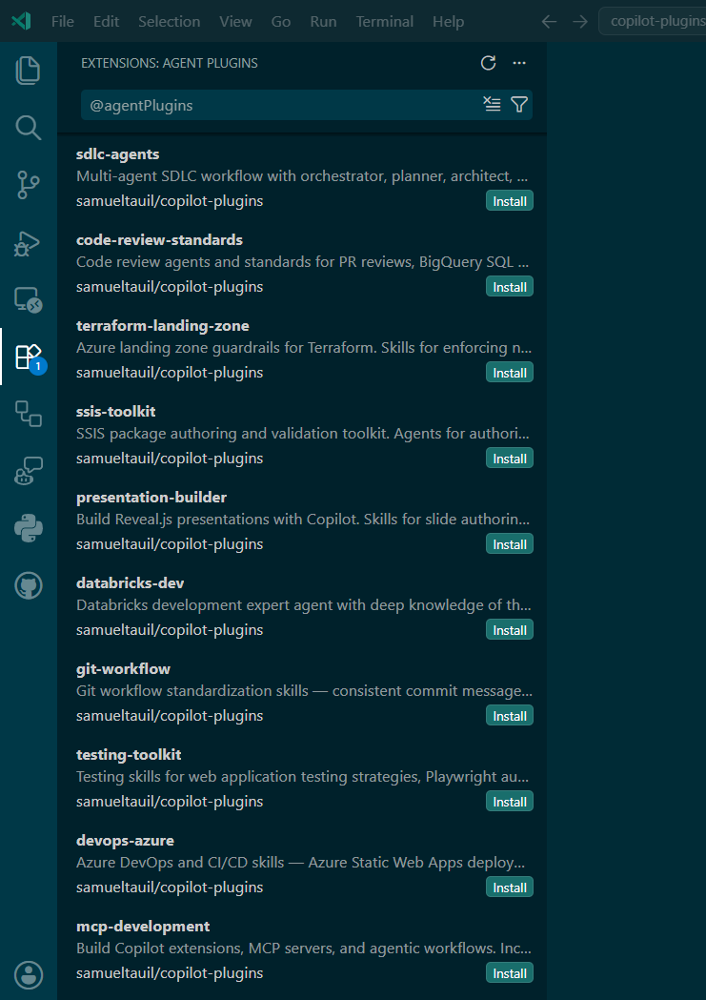

# Setup: VS Code

## Prerequisites

- Visual Studio Code 1.122 or later
- GitHub Copilot and GitHub Copilot Chat enabled for your account
- A Copilot Business or Enterprise license

> 📖 Official docs: [Agent plugins in VS Code](https://code.visualstudio.com/docs/agent-customization/agent-plugins) · [Finding and installing plugins](https://docs.github.com/en/copilot/how-tos/copilot-cli/customize-copilot/plugins-finding-installing)

## Enable plugin support

Plugin support in VS Code requires the [`chat.plugins.enabled`](vscode://settings/chat.plugins.enabled) setting, which is managed at the organization level. If you don't see plugin options, contact your Copilot admin to enable it.

## Add the marketplace

Add this marketplace to VS Code by configuring the [`chat.plugins.marketplaces`](vscode://settings/chat.plugins.marketplaces) setting.

### Option 1: VS Code settings UI

1. Open [`chat.plugins.marketplaces`](vscode://settings/chat.plugins.marketplaces) directly (click the link from VS Code), or open **Settings** (`Ctrl+,` / `⌘,`) and search for it.
2. Add `samueltauil/copilot-plugins` to the list.



### Option 2: settings.json

Add directly to your VS Code `settings.json`:

```json
{
  "chat.plugins.marketplaces": [
    "samueltauil/copilot-plugins"
  ]
}
```

### Option 3: Workspace-level (per-project)

To recommend this marketplace for a specific project, add to `.github/copilot/settings.json` or `.claude/settings.json` in the repository:

```json
{
  "extraKnownMarketplaces": {
    "custom-copilot-plugins": {
      "source": {
        "source": "github",
        "repo": "samueltauil/copilot-plugins"
      }
    }
  }
}
```

> **Note:** VS Code ships with [copilot-plugins](https://github.com/github/copilot-plugins) and [awesome-copilot](https://github.com/github/awesome-copilot) as default marketplaces. The setting above adds this marketplace alongside those defaults. This marketplace is named `custom-copilot-plugins`, so it doesn't clash with GitHub's `copilot-plugins`.

## Browse and install plugins

1. Open the **Extensions** view (`Ctrl+Shift+X` / `⇧⌘X`).
2. Click the **More Actions** menu (three dots) → **Views** → **Agent Plugins** to open the plugins view.

   

3. Type `@agentPlugins` in the search field to see available plugins from your configured marketplaces.
4. Select **Install** on any plugin you want.

   

Alternatively, you can install a plugin directly from source:

1. Open the **Command Palette** (`Ctrl+Shift+P` / `⇧⌘P`).
2. Run **Chat: Install Plugin From Source**.
3. Enter the Git repository URL (e.g., `https://github.com/samueltauil/copilot-plugins`).

## Install a plugin from Copilot CLI

Plugins installed via the Copilot CLI are automatically discovered by VS Code. If you've already run:

```bash
copilot plugin install sdlc-agents@custom-copilot-plugins
```

The plugin will appear in the **Agent Plugins - Installed** view in VS Code without any additional setup.

## Manage installed plugins

- View installed plugins: **Extensions** view → **Agent Plugins - Installed** section
- Enable/disable per workspace: right-click a plugin → **Enable/Disable for Workspace**
- Uninstall: right-click a plugin → **Uninstall**
- Update: run **Extensions: Check for Extension Updates** from the Command Palette, or enable [`extensions.autoUpdate`](vscode://settings/extensions.autoUpdate) for automatic checks every 24 hours

## Verify

After installation:

1. Open a new Copilot Chat session.
2. Check that plugin-provided agents appear in the agent picker.
3. Open **Chat: Configure Skills** to confirm plugin skills are listed.

If nothing appears, reload the VS Code window (`Developer: Reload Window`) and open a fresh chat session.
