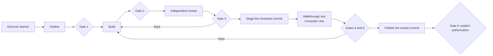

# GitHub Skills Studio

Build [GitHub Skills](https://github.com/skills) exercises and workshops that people finish and learn from.
This plugin takes you from an idea (or an existing training deck) to a published, tested exercise: it designs
with evidence from learning science, builds on the official
[exercise template](https://github.com/skills/exercise-template) and
[exercise toolkit](https://github.com/skills/exercise-toolkit), reviews independently, and walks through the
finished exercise like a real learner using Computer Use.

## What's inside

### Agents

| Agent | Use it to |
| --- | --- |
| `exercise-architect` | Run the whole lifecycle with approval gates: design, outline, build, review, test, publish |
| `exercise-reviewer` | Get an independent, report-only review (separate context, no edit permissions) |
| `learner-simulator` | Walk through an exercise as a learner with Computer Use and report execution, UI, and usability issues |

### Skills

| Skill | What it covers |
| --- | --- |
| `github-skills-studio` | Entry point: lifecycle, routing, gates, resuming work in progress |
| `learning-design` | Learner analysis, objectives and evidence, worked examples and fading, retrieval, feedback, motivation, accessibility, myths to avoid, with citations |
| `workshop-design` | Series of exercises: sequencing, spacing, capstones, timeboxing, EMU and organization setup, facilitator guide, preflight, evaluation |
| `exercise-outline` | The build contract: persona, alignment matrix, steps, triggers, grading, feedback, naming, test plan |
| `exercise-scaffold` | Repository files from templates: README with Copy Exercise button, steps, review, workflows, pins, validation |
| `exercise-content` | Step writing: story, theory, activities, confirmation cues, Having trouble hints, formatting, accessibility |
| `exercise-automation` | Triggers safe on the template-copy push, grading recipes and their validity, feedback tips, workflow security |
| `exercise-review` | Seven-lens rubric plus `validate_exercise.py`, a static validator with 80+ rules |
| `exercise-walkthrough-test` | Automated learner walkthroughs with Computer Use plus `exercise_harness.py` for repository ground truth |
| `exercise-publish` | Safe publishing, transfers, updates, toolkit upgrades, maintenance, deprecation |

## Install

```bash
copilot plugin marketplace add samueltauil/copilot-plugins
copilot plugin install github-skills-studio@copilot-plugins
```

In VS Code, add the marketplace to `chat.plugins.marketplaces` and install **github-skills-studio** from the
Extensions view (`@agentPlugins`).

## Quick start

```text
/agent github-skills-studio:exercise-architect

Create a GitHub Skills exercise that teaches developers how to protect their main branch with rulesets.
The audience uses GitHub every day but has never configured rulesets. Keep it under 40 minutes.
```

Or call skills directly:

```text
/github-skills-studio
/github-skills-studio:exercise-review  Review the exercise in this repository.
/github-skills-studio:exercise-walkthrough-test  Test samueltauil/my-exercise-staging in ui mode under my account.
/github-skills-studio:workshop-design  Turn this half-day Copilot workshop agenda into a series of exercises.
```

## How it works



### Learning science, applied

Every phase uses principles with real evidence, labelled by strength, and avoids popular myths:

- **Cognitive load and fading:** step 1 is a complete worked example; later steps fade to goals with hints.
- **Retrieval and generation:** later steps reuse earlier skills without the recipe; the review asks recall
  questions with collapsible answers; learners write their own messages and prompts where grading allows.
- **Feedback that moves learners forward:** failed checks name the problem and one next action, describe the
  work rather than the person, and render tips only on failure.
- **Assessment validity:** every check states what it proves and what it does not; no mastery claims from proxies.
- **Motivation and accessibility:** relevance, early success, honest progress, alt text, descriptive links,
  non-color status, disclosed costs and requirements.
- **Myths avoided:** no learning styles, no retention pyramids, no ten-minute attention rule.

See `skills/learning-design/references/evidence-base.md` for the principles, caveats, and references.

### Static validator

```bash
python skills/exercise-review/scripts/validate_exercise.py <exercise-repo> [--format markdown] [--online]
```

Checks structure, workflow wiring (`Step N` names, enable targets, each step posted by the right workflow, start
and finish workflows), copy-time trigger safety, grading that actually gates progress, `wait-for-workflow`
conclusions, `find-comment` filtering, permissions, script injection, template variables, toolkit pins (tags or
commit SHAs), step anatomy, list rendering, images (including letter case), links, README and Copy Exercise
parameters, and learning-design heuristics. Standard library only; PyYAML is used if installed.

### Walkthrough testing with Computer Use

The `learner-simulator` agent plays a literal novice in a disposable copy of your exercise, made from a staging
template at the exact commit you reviewed:

- **Execution:** copy → start → each step's action → trigger → grading → feedback → next step → review →
  finish. Graded steps also get two kinds of planned mistakes: one the grader must reject with useful feedback,
  and one the trigger filters out, which proves learners get hints when Mona stays silent.
- **UI fidelity:** every label, location, link, image, and screenshot in the instructions is checked against
  the real UI; Mona's comments are linted for unrendered template syntax, broken images, and relative links.
- **Usability:** cognitive walkthrough per instruction, Nielsen heuristics, a Single Ease rating per step,
  feedback latency, and accessibility spot checks.

It follows the Computer Use action policy: it asks before every submission (creating the repository, committing,
pull requests, comments, codespaces, cleanup), one approval per action, and hands sign-in to you. A `cli` mode
repeats the execution checks with `git` and `gh` from an approved run plan, without Computer Use, for quick
regressions. Enable Computer Use in Copilot CLI with `/computer on`.

```bash
python skills/exercise-walkthrough-test/scripts/exercise_harness.py status --repo <owner>/<learner-copy>
```

## Requirements

- GitHub Copilot CLI or VS Code with agent plugins.
- `gh` signed in (`repo` and `workflow` scopes; `codespace` to clean up test codespaces; `delete_repo` only to delete
  test copies).
- Python 3.9 or later for the validator and harness.
- Computer Use enabled for walkthrough tests in `ui` mode (without it, use `cli` mode for execution checks).

## How this differs from gh-skills-builder

[gh-skills-builder](https://awesome-copilot.github.com/plugin/gh-skills-builder/) is a solid, approval-gated
outline → bootstrap → review → publish loop focused on the exercise template contract. This plugin covers that
loop and adds: an evidence-based learning-design layer used in every phase, multi-exercise workshop design with
EMU logistics and facilitation, an independent reviewer agent with no edit tools, a static validator, automated
learner walkthroughs with Computer Use backed by a repository harness, and maintenance guidance.

## Sources

- [skills/exercise-creator](https://github.com/skills/exercise-creator) guides and references
- [skills/exercise-template](https://github.com/skills/exercise-template) and
  [skills/exercise-toolkit](https://github.com/skills/exercise-toolkit) (verified against toolkit `v0.9.3`)
- [GitHub Skills for EMU](https://github.com/skills/skills-for-emu)
- Learning science references in `skills/learning-design/references/evidence-base.md`
