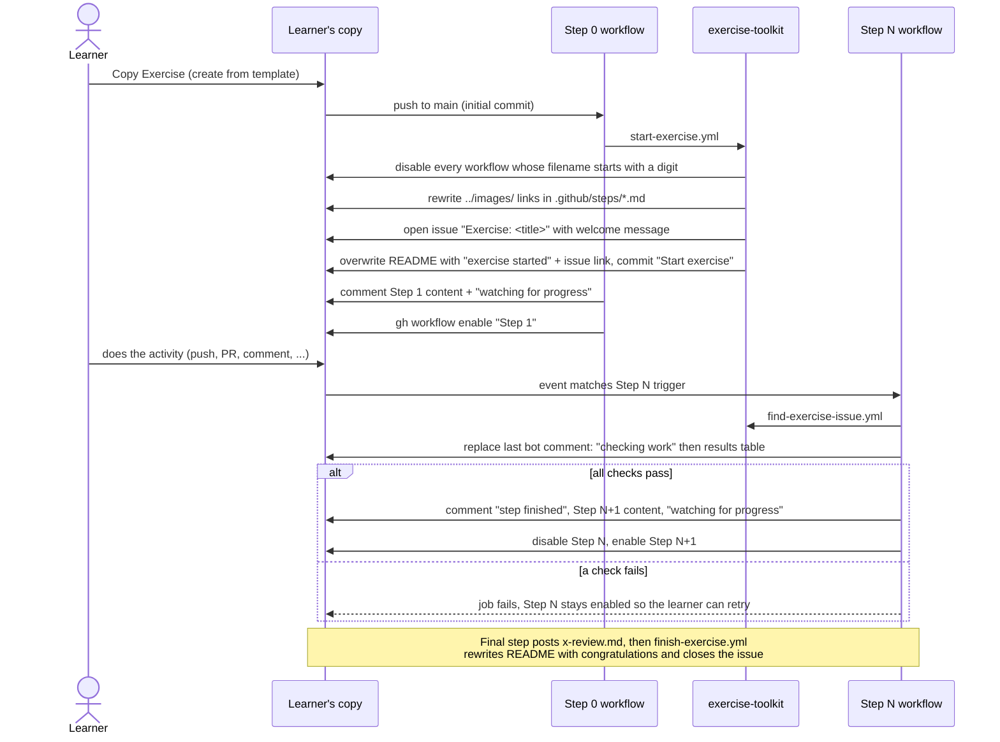

# GitHub Skills framework contract

The technical contract every exercise built with this plugin must satisfy. It is derived from
[`skills/exercise-template`](https://github.com/skills/exercise-template),
[`skills/exercise-toolkit`](https://github.com/skills/exercise-toolkit),
[`skills/exercise-creator`](https://github.com/skills/exercise-creator) and the published exercises in the
[`skills`](https://github.com/skills) organization. Where this contract deliberately differs from the
template, the difference is listed in [Deliberate improvements over the template](#deliberate-improvements-over-the-template).

> [!IMPORTANT]
> Versions and behaviors below were verified against `exercise-toolkit` **v0.9.3**. Before building, re-check
> the latest release (see [Pinned versions](#pinned-versions)) and re-read the `workflow_call` block of each
> reusable workflow if you pin anything newer.

## How an exercise runs



## Canonical file set

```text
README.md                               # template landing page; overwritten in the learner's copy
LICENSE                                 # MIT in published exercises
.gitignore
.devcontainer/devcontainer.json         # only if the exercise uses a codespace
.github/images/                         # images referenced from steps as ../images/<file>
.github/steps/1-step.md                 # one file per step, number first
.github/steps/2-step.md
.github/steps/3-step.md
.github/steps/x-review.md               # recap posted after the last step ("x-", not a number)
.github/workflows/0-start-exercise.yml  # Step 0
.github/workflows/1-step.yml            # Step 1 ... posts step 2
.github/workflows/2-step.yml
.github/workflows/3-step.yml            # final step: posts x-review.md and finishes the exercise
```

Optional, author-facing (never needed by the learner):

```text
.github/exercise-outline.md             # the approved outline this plugin builds from
```

## Naming invariants

| Concept | Rule | Why it matters |
| --- | --- | --- |
| Step content | `.github/steps/N-<slug>.md`, opening with `## Step N: <title>` | Number keeps order; `N-step.md` is the default slug |
| Step workflow file | `.github/workflows/N-<slug>.yml`, filename **starts with a digit** | `start-exercise.yml` disables only files matching `^\.github/workflows/[0-9].*\.(yml\|yaml)$` |
| Step workflow name | `name: Step N` | `gh workflow enable "Step N"` resolves the workflow by this name |
| Start workflow | `0-start-exercise.yml`, `name: Step 0 # Start Exercise` | YAML comment is ignored, declared name is `Step 0` |
| Final workflow | highest `N`, `name: Step N # Last step of the exercise` | Marker is a comment for humans; the name stays `Step N` |
| Review content | `.github/steps/x-review.md` | Posted by the final workflow, never by a numbered step file |
| Non-exercise workflows | filename must **not** start with a digit (for example `ci.yml`) | Otherwise Step 0 disables them when the exercise starts |

Additional invariants:

- Workflow `Step N` posts the content for step `N+1`. `Step 0` posts step 1. The final workflow posts
  `x-review.md`.
- Every `gh workflow enable "Step N"` names a workflow that exists. Every `STEP_N_FILE` / `REVIEW_FILE` env
  value points at a file that exists.
- Step numbers are contiguous from 1. Keep the exercise to **five steps or fewer**
  (see the [exercise-creator guidance](https://github.com/skills/exercise-creator/blob/main/docs/reference/exercise.md)).

## Toolkit API

### Reusable workflows

| Workflow | Inputs | Outputs | What it does |
| --- | --- | --- | --- |
| `start-exercise.yml` | `exercise-title` (required), `intro-message` (required), `issue-title-prefix` (default `"Exercise: "`) | `issue-number`, `issue-url` | Disables numbered workflows, rewrites `../images/` links in `.github/steps/*.md` to blob URLs, opens the exercise issue with the welcome template, overwrites `README.md` with the "exercise started" template, commits `Start exercise` |
| `find-exercise-issue.yml` | `issue-title-text` (default `"Exercise"`) | `issue-number`, `issue-url` | Returns the **newest** issue (any state, last 50, pull requests excluded) whose title contains the text; fails if none |
| `finish-exercise.yml` | `issue-url` (required), `exercise-title`, `update-readme-with-congratulations` (default `true`) | none | Overwrites `README.md` with the congratulations template (share buttons), comments "exercise finished", closes the issue |

Paths: `skills/exercise-toolkit/.github/workflows/<file>@<tag>`.

### Composite actions

| Action | Inputs | Outputs | Use |
| --- | --- | --- | --- |
| `skills/exercise-toolkit/actions/file-exists@<tag>` | `file` | none (fails if missing) | Learner created or kept a file |
| `skills/exercise-toolkit/actions/wait-for-workflow@<tag>` | `workflow-id` (required), `head-sha`, `status` (default `completed`), `polling-interval` (10), `timeout` (180), `fail-on-timeout` (true), `owner`, `repo`, `token` | `conclusion` | Grade a workflow the learner wrote or triggered, without `workflow_run` |
| `skills/exercise-toolkit/actions/repository-elapsed-time@<tag>` | none | `minutes`, `human-readable` | Time-aware messages or checks |
| `skills/action-keyphrase-checker@v2` | `text-file` **or** `text`, `keyphrase` (required), `case-sensitive` (default `false`), `minimum-occurrences` (default `1`), `maximum-occurrences` | `occurrences` | File or text contains a phrase within a count range |

### Markdown templates

Check the toolkit out at the same tag (`path: exercise-toolkit`) and point `GrantBirki/comment` at these files.
Do not copy them into the exercise.

| Template (`markdown-templates/...`) | Variables | Posted when |
| --- | --- | --- |
| `step-feedback/watching-for-progress.md` | none | After each step's content (not after the review) |
| `step-feedback/checking-work.md` | none | Replaces Mona's last comment when grading starts |
| `step-feedback/step-results-table.md` | `step_number`, `results_table` (list of `{description, passed}`), optional `tips` (list of strings) | Replaces the "checking work" comment with pass/fail rows |
| `step-feedback/step-finished-prepare-next-step.md` | `next_step_number` | Before the next step's content |
| `step-feedback/step-mistake.md` | `feedback_message` | Targeted recovery message for a specific mistake |
| `step-feedback/lesson-review.md` | none | Before `x-review.md` |
| `step-feedback/welcome.md` | used by `start-exercise.yml` | Issue body |
| `step-feedback/exercise-finished.md` | used by `finish-exercise.yml` | Final comment |
| `readme/exercise-started.md` | used by `start-exercise.yml` | README while the exercise runs |
| `readme/exercise-finished.md` | used by `finish-exercise.yml` | README after completion |

## Pinned versions

Known-good set, compatible with the [GitHub Skills for EMU strict allowlist](https://github.com/skills/skills-for-emu/blob/main/actions-allowlist/strict.txt):

| Dependency | Pin | Notes |
| --- | --- | --- |
| `skills/exercise-toolkit` (workflows, actions, and the `ref:` of its checkout) | `v0.9.3` | One tag everywhere. `exercise-template` still pins `v0.9.1` |
| `actions/checkout` | `v6` | |
| `GrantBirki/comment` | `v2.1.1` | `v3` exists (TypeScript rewrite); not yet used by the template or allowlisted |
| `peter-evans/find-comment` | `v4` | |
| `skills/action-keyphrase-checker` | `v2` | `v1` runs on Node 20; `v2` requires Node 24 |
| `actions/github-script` | `v9` | For custom checks |

Resolve the latest toolkit release before building and confirm the tag exists:

```bash
gh release view --repo skills/exercise-toolkit --json tagName,isDraft,isPrerelease
git ls-remote --tags https://github.com/skills/exercise-toolkit "refs/tags/<tag>"
```

Rules:

- Never pin `@main`. Never pin a draft or prerelease: a draft release has no git tag and every `uses:` breaks.
- Never mix refs. The same toolkit tag appears in every `uses: skills/exercise-toolkit/...` and every
  `ref:` of an `actions/checkout` of `skills/exercise-toolkit`.
- If you adopt a newer tag, ask the author first, apply it everywhere, and re-run the static validator.
- Exercises for Enterprise Managed User (EMU) organizations with a strict Actions allowlist can only use
  actions on that list. `repository-elapsed-time` and `wait-for-workflow@v0.9.3` are not on it today; check
  before using them, or tell facilitators to allow them.
- Full-length commit SHA pins are the strongest supply-chain protection. Use them for private or internal
  workshops where you control the allowlist; public exercises follow the tag convention so allowlists match.

## Behaviors authors must design around

1. **The README is replaced.** In the learner's copy, `start-exercise.yml` overwrites `README.md` and
   `finish-exercise.yml` overwrites it again. The template README is only a landing page; never put content
   the learner needs during the exercise there.
2. **Image links are rewritten only in one form.** `start-exercise.yml` rewrites
   `../images/<file>` inside `.github/steps/*.md` to
   `https://github.com/<repo>/blob/main/.github/images/<file>?raw=true`. Other relative forms stay broken in
   issue comments. File names must not contain spaces, quotes, or parentheses.
3. **The exercise issue is found by title.** `find-exercise-issue.yml` picks the newest issue whose title
   contains `Exercise`. If an activity asks learners to create issues, make sure those titles cannot
   contain that word, or set a distinctive `issue-title-prefix` and the matching `issue-title-text` in every
   step workflow.
4. **Step files are always rendered with Nunjucks.** `GrantBirki/comment@v2.1.1` renders every `file:` it
   posts, whether or not `vars:` is passed. Values come only from `vars:`: any variable not passed (for example
   `{{ login }}` when the step posts without `vars:`) renders as an empty string. Any `${{ ... }}`, and any
   literal `{{`, `{%`, or `{#` you want learners to see, must be wrapped in `...`, or it is
   mangled.
5. **Everything is enabled in a fresh copy.** GitHub does not copy the enabled or disabled state of
   workflows from a template. The initial push to `main` can trigger any step workflow whose trigger matches
   before Step 0 disables it. Design triggers that cannot match that push (see the automation skill's
   triggers reference).
6. **Mona's own actions do not advance the exercise.** Events created with `GITHUB_TOKEN` (Mona's comments,
   commits, and issues) do not start new workflow runs. The exceptions are `workflow_dispatch` and
   `repository_dispatch`, and `pull_request` events of type `opened`, `synchronize`, or `reopened` created
   with `GITHUB_TOKEN`, which create runs that wait for someone with write access to approve them
   ([GitHub Docs](https://docs.github.com/actions/concepts/security/github_token#when-github_token-triggers-workflow-runs)).
   Trigger steps on what the learner does.
7. **The source repository must be a template before `push` triggers are enabled.** Step 0 is guarded by
   `!github.event.repository.is_template`; if the source repository is not marked as a template, pushing to
   it starts an exercise in the source repository.
8. **Failed grading leaves the step open.** When `check_step_work` fails, `post_next_step_content` is
   skipped, so the step workflow stays enabled and the learner can fix and retry.
9. **Learners take about four times longer than experts.** The exercise-creator guidance observes roughly a
   4x ratio and that many learners drop off after 30 to 45 minutes. Budget time accordingly.

## Workflow chaining rules

- Fresh copy: Step 0 runs, the toolkit disables every numbered workflow (including Step 0), then Step 0's
  own `post_next_step_content` job enables `Step 1`. Step 0 never disables itself explicitly.
- Each intermediate step's last action is:

  ```yaml
  - name: Disable current workflow and enable next one
    run: |
      gh workflow disable "${{ github.workflow }}"
      gh workflow enable "Step N+1"
    env:
      GH_TOKEN: ${{ secrets.GITHUB_TOKEN }}
  ```

- The final step only disables itself and calls `finish-exercise.yml`.
- When a step has a grading job, `post_next_step_content.needs` **must** include `check_step_work`.
  `exercise-template`'s `2-step.yml` ships with `needs: [find_exercise]` and the fix in a comment; inheriting
  that silently disables grading.
- Grading jobs replace Mona's last comment, never create new ones. Find it with
  `peter-evans/find-comment@v4` using `comment-author: github-actions[bot]` and `direction: last`, so a
  learner's own comment is never targeted.

## Permissions matrix

Set `permissions: {}` at the workflow level and grant each job only what it uses. A workflow-level grant
applies to every job, which hands `actions: write` (enable or disable any workflow) to the learner-triggered
grading job.

| Workflow | Job | `contents` | `actions` | `issues` | Why |
| --- | --- | --- | --- | --- | --- |
| `0-start-exercise.yml` | `start_exercise` | write | write | write | Toolkit commits README, disables workflows, opens issue |
| | `post_next_step_content` | read | write | write | Checkout, comment, enable `Step 1` |
| `N-step.yml` | `find_exercise` | | | read | Locate the exercise issue |
| | `check_step_work` | read | **none** | write | Read learner files, update the feedback comment |
| | `post_next_step_content` | read | write | write | Checkout, comment, disable self, enable next |
| Final `N-step.yml` | `find_exercise` | | | read | |
| | `post_review_content` | read | write | write | Checkout, comment, disable self |
| | `finish_exercise` | write | | write | Toolkit commits README, closes the issue |

Add `pull-requests: read` to a grading job only when a check reads pull request data through the API.

## Deliberate improvements over the template

| Area | `exercise-template` | This contract | Reason |
| --- | --- | --- | --- |
| Permissions | workflow-level, includes `actions: write` | `permissions: {}` plus per-job grants | Least privilege; grading cannot toggle workflows |
| Start trigger | `push` commented out | `push` to `main` enabled, plus `workflow_dispatch` | The README promises an automatic start |
| Grading wiring | `needs: [find_exercise]` with fix in a comment | `needs: [find_exercise, check_step_work]` whenever grading exists | Otherwise failures do not block progress |
| `find-comment` | `direction: last` only | adds `comment-author: github-actions[bot]` | Never overwrite the learner's comment |
| Toolkit pin | `v0.9.1` | latest verified release, `v0.9.3` | Bug fixes, allowlist parity |
| Keyphrase checker | `v1` | `v2` | Node 24 runtime |
| Final workflow file | `3-last-step.yml` | `N-step.yml` named `Step N # Last step of the exercise` | One filename pattern, as in published exercises |
| Troubleshooting | one block per step | one `Having trouble? 🤷` block after **each** activity | Hints sit next to the work they support |
| Feedback | pass/fail table only | table rows phrased as next actions, optional `tips` | Feed-forward feedback (see the learning-design skill) |
