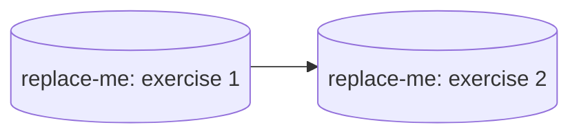

# Workshop plan: (replace-me: workshop title)

## Overview

- **Capability at the end:** (replace-me: observable outcome for the whole workshop)
- **Audience:** (replace-me: persona summary; link to the learner analysis)
- **Delivery:** (replace-me: instructor-led / self-paced / hybrid), (replace-me: duration)
- **Environment:** (replace-me: personal accounts / learning organization / EMU learning organization)

## Prerequisites and pre-work

- (replace-me: accounts, plans, tools)
- (replace-me: pre-work exercise with link and expected time)

## Exercise sequence

| # | Exercise | Objective (one new skill) | Reuse / adapt / author | Depends on | Tested time |
| --- | --- | --- | --- | --- | --- |
| 1 | (replace-me) | (replace-me) | (replace-me) | none | (replace-me) |

## Agenda

| Time | Block | Facilitator does | Learners do | Checkpoint |
| --- | --- | --- | --- | --- |
| 0:00 | Welcome and setup | Frame the outcome; verify access | Sign in, open the first exercise | Everyone sees the exercise issue |
| (replace-me) | (replace-me) | (replace-me) | (replace-me) | (replace-me) |
| (replace-me) | Break | | | |
| (replace-me) | Capstone | | | |
| (replace-me) | Wrap-up | Recap, survey, next steps | Reflection, survey | |

## Spacing and retrieval plan

- (replace-me: which earlier skill each later exercise reuses without full instructions)
- (replace-me: follow-up on a later day)

## Environment checklist

See the preflight checklist. Owner: (replace-me).

## Facilitation

- Lead: (replace-me). Helpers: (replace-me). Help channel: (replace-me).
- Stuck-learner protocol and troubleshooting: see the facilitator guide.

## Evaluation

| Level | Instrument | Owner |
| --- | --- | --- |
| Reaction | (replace-me) | (replace-me) |
| Learning | (replace-me) | (replace-me) |
| Behavior | (replace-me) | (replace-me) |

## Risks and mitigations

| Risk | Mitigation |
| --- | --- |
| (replace-me) | (replace-me) |
