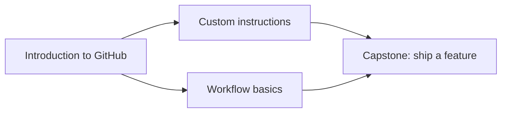

# Sequencing a series of exercises

## From capabilities to exercises

1. Write the workshop capability as an observable outcome ("Participants can ship a change through a protected
   branch with automated checks and a Copilot code review").
2. Decompose it into skills. Each skill becomes one exercise when it is new, observable, and teachable in five
   steps or fewer.
3. Mark each skill: **reuse** (a published GitHub Skills exercise fits), **adapt** (fork a published exercise
   and change the scenario), or **author** (build with this plugin).
4. Order skills by dependency, then by motivation: put the earliest visible win first.

| Skill | New or review | Exercise | Reuse / adapt / author | Depends on | Time (tested) |
| --- | --- | --- | --- | --- | --- |
| Branch, commit, pull request | Review | [Introduction to GitHub](https://github.com/skills/introduction-to-github) | Reuse (pre-work) | none | |
| ... | | | | | |

## Prerequisite graph

Draw it as a mermaid graph in the workshop plan. Every edge is a skill a later exercise uses without
re-teaching it.

## Spiral and cumulative retrieval

- Revisit a concept in a more demanding context in each exercise (create a branch, then use it for a pull
  request, then protect it).
- Open each later exercise with a short retrieval task that uses an earlier skill without the full
  instructions, plus a hint and the correct answer afterwards.
- Interleave only choices learners have already met (for example, choosing the right trigger among two you
  have taught).
- Spacing across days beats repetition within one session. For multi-day programs, schedule a short revisit
  exercise or challenge on a later day.

## Repository isolation

Every exercise is copied from its own template, so:

- Ship starter code in each template that needs it.
- If an exercise must reference earlier work, tell learners exactly how (for example, "Open your
  `skills-introduction-to-github` repository in a new tab").
- Do not build grading that depends on another repository unless the learner provides its URL in an issue
  comment and the check can read it.

## Capstone

End a series with an integration exercise:

- A realistic task that needs several earlier skills, with lighter guidance than any previous exercise.
- Grading on outcomes (a pull request merged with passing checks) rather than on exact steps.
- A reflection prompt in the review: what would you do differently in your own repository?

## Converting an existing training

| Training element | Becomes |
| --- | --- |
| Module objective | Exercise objective (one new skill) |
| Slide explanation | Step theory (awareness level) plus inline links to Docs |
| Demo | Step 1 worked example with exact instructions |
| Lab task | Activity with a triggering action and a check |
| Lab "solution" | Having trouble hints and the review's recall answers |
| Q&A or quiz | Recall questions in `x-review.md`, or an `issue_comment` answer step |
| Homework | Follow-up exercise or "Take it to your work" challenge |

## Timing heuristics (validate with testers)

- Learners take about four times as long as an expert, and many drop off after 30 to 45 minutes (GitHub Skills
  practitioner guidance).
- Add 10 to 20 minutes at the start for accounts, Codespaces creation, and Copilot sign-in.
- Leave a 15 to 25 percent buffer per block for stragglers and questions.
- Prefer natural pause points between exercises for breaks.
